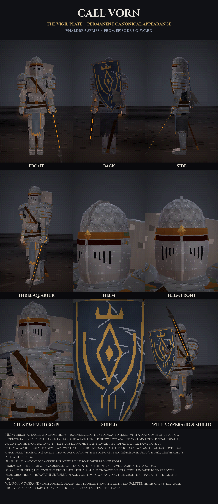

# CAEL VORN — PERMANENT CHARACTER DESIGN RECORD

| | |
|---|---|
| **CHARACTER** | CAEL VORN, the wanderer of the Grey Road, successor of the Grey Vigil |
| **ARMOR** | **The Vigil Plate**, an original armour broadly inspired by historical close-helmed knights; no game asset was copied |
| **HELMET** | An original enclosed silver-grey close helm with a rounded, slightly elongated skull and a low comb. **One narrow horizontal eye-slit** with a centre bar and a faint ember glow. **Two angled columns of narrow vertical breaths** on the lower visor, over a shallow centre keel. An aged-bronze brow band carries his **brass diamond sigil**. Bronze visor rivets and a three-lame gorget. |
| **CHEST** | Weathered silver-grey steel: a keeled breastplate with an etched band and a bronze keel inlay, a plackart, and three-lame faulds; leather belt and chest strap |
| **SHOULDERS** | Matching layered, rounded pauldrons on both shoulders (a domed cap and three lames) with aged-bronze edges |
| **ARMS / LEGS** | Couters, engraved vambraces with bronze cuffs, steel gauntlets; cuisses, poleyns with side wings, greaves, laminated sabatons |
| **UNDERARMOR** | Dark chainmail, dark charcoal cloth, a blue-grey front panel with a bronze hem, a blue-grey scarf whose tail hangs over his right shoulder |
| **COLORS** | Silver-grey steel, aged bronze `#8A6A3A`, dark charcoal `#2E2E34`, subtle blue-grey `#5A6E8C`, his ember `#FF7A22` |
| **SHIELD** | An original elongated heater shield: steel rim with bronze rivets, blue-grey field, and the **Watchful Ember** emblem in aged gold. The emblem is a crown bar with three points, a lozenge with an inner diamond, two cradling hands, and three falling lines. Battle-scratched. |
| **WEAPON** | **Vowbrand** (unchanged since Episode 1): a long single-edged dark-iron blade with a hooked back-spur, an ember vein, an open octagonal brass ring-guard and a leather grip. Carried in a leather scabbard on the right hip. |
| **HANDEDNESS** | **Left-handed.** Vowbrand in the left hand, shield on the right arm, lantern on the right hip |
| **ALWAYS WITH HIM** | The Pilgrim's Spark: a small hexagonal iron lantern holding a live ember, at his right hip |
| **FACE** | Never shown; a dark mail coif is worn under the helm |
| **BODY** | The same rig and proportions as Episodes 1–2: about 1.95 m, lean, a slight weary hunch |
| **VISUAL STYLE** | PS1/PS2 low-poly dark fantasy: 360×640 internal render, affine texture warp, vertex snapping, Gouraud lighting, fog, Bayer dither, 15-bit colour |
| **STATUS** | **PERMANENT CANONICAL APPEARANCE FROM EPISODE 3 ONWARD** |

## Rules for every future episode
1. Build Cael with `buildCaelVigil()` from [`the-forgotten-armory/render/src/vigil.js`](the-forgotten-armory/render/src/vigil.js) and the shield from `j.shield` (`placeShield(j, j.shield, 'arm' | 'back')`). **Do not edit `vigil.js`.** Change his equipment only if the series owner explicitly asks.
2. Never return to the Episode 1–2 armour (keel-prow helm, oxblood half-cloak, crimson tabard) except as remembered or discarded objects.
3. Never swap the helm for an open, horned or crowned helm, a hood, or any variant. The shield and its emblem never change.
4. Only poses, actions, camera and environment lighting may change.

## History
- **Episodes 1–2** (*The Last Ember*, *The Silent Kingdom*): the wanderer's armour. Keel-prow helm with a chevron eye-slit and a right-temple spur, layered plates on the left shoulder, an oxblood half-cloak over the right, a crimson Weeping Ember tabard.
- **Episode 3** (*The Armor That Would Last Forever*): in a forgotten fortress, the armour of the Grey Vigil wakes to the same diamond sigil he has always worn. He casts off the old armour piece by piece and takes up the Vigil Plate and the Watchful Ember shield.
