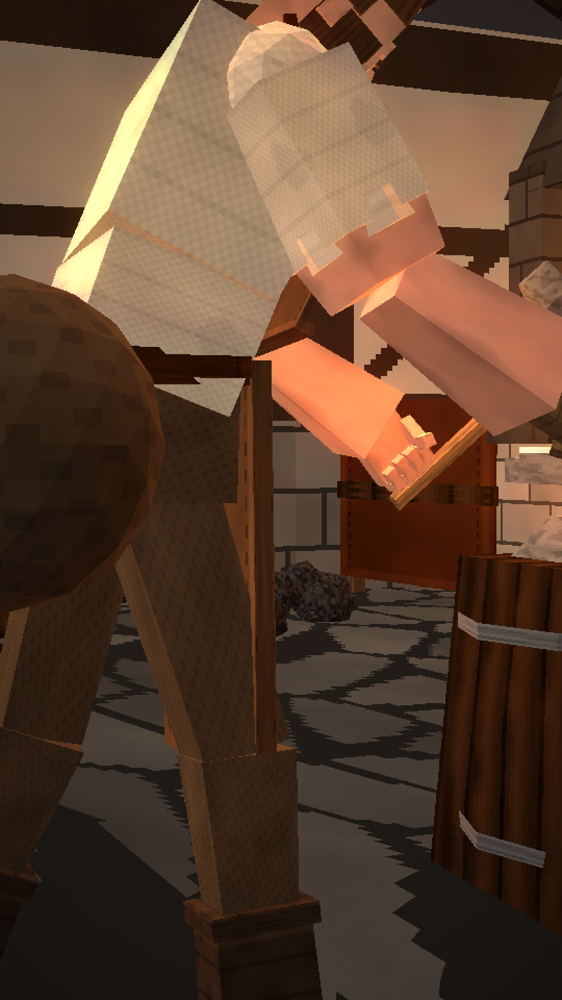

# BEING BORN AS A BLACKSMITH IN MEDIEVAL TIMES WAS HORRIFYING



A ~62-second vertical (9:16, 1080×1920) historically inspired documentary in a PS1/PS2-era low-poly style. It follows one medieval blacksmith from his birth beside the forge to old age:
- hauling coal as a boy
- the apprentice's missed blow
- burns
- endless customers
- late nights
- trembling hands
- a hammer that outlives him

There are no kings, no magic and no happy ending.

**Final video:** [`output/being_born_as_a_blacksmith_in_medieval_times_was_horrifying.mp4`](output/being_born_as_a_blacksmith_in_medieval_times_was_horrifying.mp4)

| | |
|---|---|
| Script, timing, design, animation, audio, quality check | [`docs/PRODUCTION_NOTES.md`](docs/PRODUCTION_NOTES.md) |
| Design sheet (turnaround, face, hands, ages 7 / 12 / old, father, apprentice, anvil) | [`images/00_design_sheet.png`](images/00_design_sheet.png) |
| 26 scene keyframes | [`images/`](images/) |
| Contact sheet | [`docs/contact_sheet.jpg`](docs/contact_sheet.jpg) |

## Code
- `render/src/smith.js`:
  - the blacksmith on one rig for every age, plus his father and the apprentice;
  - hands with jointed fingers that wrap the hammer and the tongs;
  - the hammer, tongs, hot bar and sparks;
  - the strike system: keyed poses with an exact contact point, sparks and body reaction on contact, and the delayed backside wobble.
- `render/src/forge.js`:
  - the smithy: hearth, hood and chimney, working bellows, anvil, quench tub, workbench, racks, horseshoes and grindstone;
  - the village on a cold morning (and at night);
  - the family home.
- `render/src/shots.js` and `render/src/film.js`: the 26 shots and the timeline.
- `audio/`: the narration lines, the procedural score and sound design (`synth.py`, with hammer hits on the animation's contact frames), and the subtitles.

This film renders at 540×960 internally (2× upscale) with smoother colour and reduced texture warping, so faces, hands, tools and textures stay readable. The settings are in `render/index.html`.

Rebuild everything:

```bash
./build.sh
```
