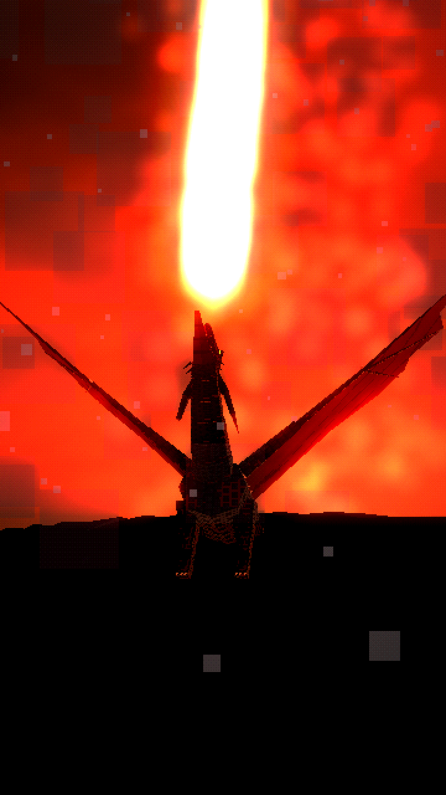

# WHAT IF YOU WERE BORN AS A DRAGON?



A ~58-second vertical (9:16, 1080×1920) second-person dark-fantasy "What If" short in a PS1/PS2-era low-poly style. You hatch beneath a volcano, grow through four life stages, are hunted by every kingdom, and discover why they were right.

**Final video:** [`output/what_if_you_were_born_as_a_dragon.mp4`](output/what_if_you_were_born_as_a_dragon.mp4)

| | |
|---|---|
| Script, timing, dragon design, audio, quality check | [`docs/PRODUCTION_NOTES.md`](docs/PRODUCTION_NOTES.md) |
| Dragon design sheet (egg → hatchling → juvenile → young → adult → ancient, plus the bones) | [`images/00_dragon_design_sheet.png`](images/00_dragon_design_sheet.png) |
| 16 scene keyframes | [`images/`](images/) |
| Contact sheet | [`docs/contact_sheet.jpg`](docs/contact_sheet.jpg) |

## Code
- `render/src/dragon.js`: the original dragon, one rig for every life stage, with per-frame wing membranes, fire breath, the egg and the skeleton.
- `render/src/env.js`: the lava cavern, the volcano world and village, hunters, the palisade camp, armies, banners.
- `render/src/shots.js` and `render/src/film.js`: the 21 shots and the timeline.
- `audio/`: narration lines, procedural roars, fire, wings, battle and score (`synth.py`), and subtitles.

Rebuild everything:

```bash
./build.sh
```
