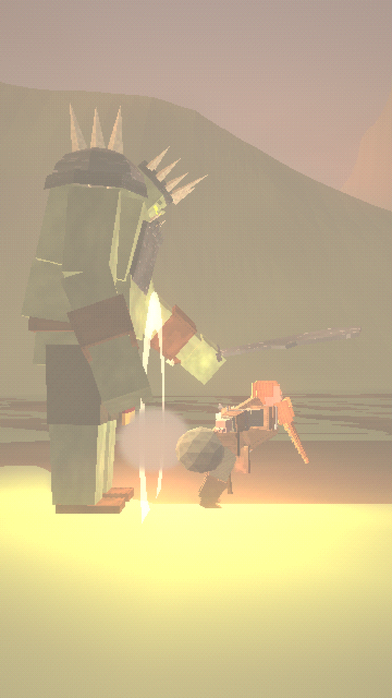

# WHAT IF YOU WERE BORN AS A DWARF?



A ~64-second vertical (9:16, 1080×1920) dark-fantasy comedy in the PS1/PS2 low-poly style. It plays like a serious fantasy documentary about the most ridiculous dwarf in history. He is born with an enormous backside and trains as a warrior, which goes badly when he falls into the mud. He forges legendary weapons, defeats the orc king with a secret weapon, and becomes the greatest dwarf king of all.

**Final video:** [`output/what_if_you_were_born_as_a_dwarf.mp4`](output/what_if_you_were_born_as_a_dwarf.mp4)

| | |
|---|---|
| Script, timing, design, look, audio, quality check | [`docs/PRODUCTION_NOTES.md`](docs/PRODUCTION_NOTES.md) |
| Dwarf design sheet (turnaround, face, axe, newborn, child, king, his people, the orc king) | [`images/00_dwarf_design_sheet.png`](images/00_dwarf_design_sheet.png) |
| 24 scene keyframes | [`images/`](images/) |
| Contact sheet | [`docs/contact_sheet.jpg`](docs/contact_sheet.jpg) |

## Code
- `render/src/dwarf.js`:
  - the protagonist on one rig (newborn → child → warrior → king), with the analytic backside spring physics;
  - the rune axe and hammers;
  - the other dwarves and the orc king;
  - the instanced orc horde and dwarf crowds.
- `render/src/dworld.js`:
  - the green mountain valley and village;
  - the family home;
  - the training yard;
  - the underground forge with its rune door;
  - the fortress gate, ramparts and battlefield;
  - the throne hall with its statue.
- `render/src/shots.js` and `render/src/film.js`: the 25 shots and the timeline.
- `render/src/sheet.js`: the design-sheet views.
- `audio/`: the narration lines, the procedural score and comedy sound design (`synth.py`), and the subtitles.

Rebuild everything:

```bash
./build.sh
```
