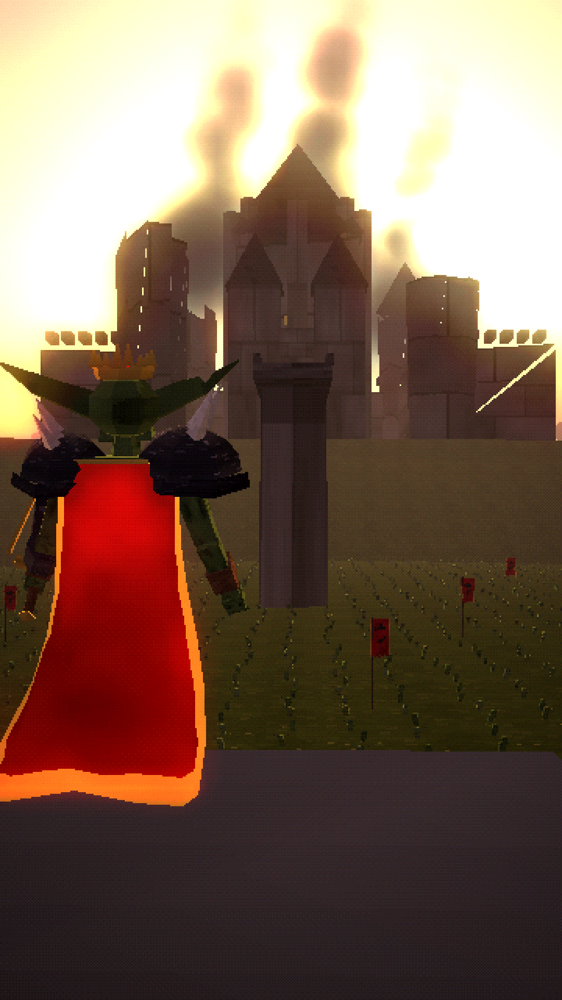

# WHAT IF YOU WERE BORN AS A GOBLIN?



A ~62-second vertical (9:16, 1080×1920) second-person "What If" short in a bright, PS1/PS2-era low-poly dark-fantasy world. You are born the weakest goblin in the forest, survive the knights who burn your home, grow through the seasons, take a brute's armour, and return as king.

**Final video:** [`output/what_if_you_were_born_as_a_goblin.mp4`](output/what_if_you_were_born_as_a_goblin.mp4)

| | |
|---|---|
| Script, timing, design, look, audio, quality check | [`docs/PRODUCTION_NOTES.md`](docs/PRODUCTION_NOTES.md) |
| Goblin design sheet (runt → survivor → warlord → king, plus knight, brute and wolf) | [`images/00_goblin_design_sheet.png`](images/00_goblin_design_sheet.png) |
| 19 scene keyframes | [`images/`](images/) |
| Contact sheet | [`docs/contact_sheet.jpg`](docs/contact_sheet.jpg) |

## Code
- `render/src/goblin.js`: the goblin (one rig for every stage), the tribe, knights, the brute, the dire wolf, a hare, and instanced hordes.
- `render/src/gworld.js`: sunlit forest with light shafts, the settlement, overgrown ruins, banners, skies and lighting, and fine terrain.
- `render/src/shots.js` and `render/src/film.js`: the 22 shots and the timeline.
- `audio/`: narration lines, procedural forest, combat and army sound and score (`synth.py`), and subtitles.

Rebuild everything:

```bash
./build.sh
```
