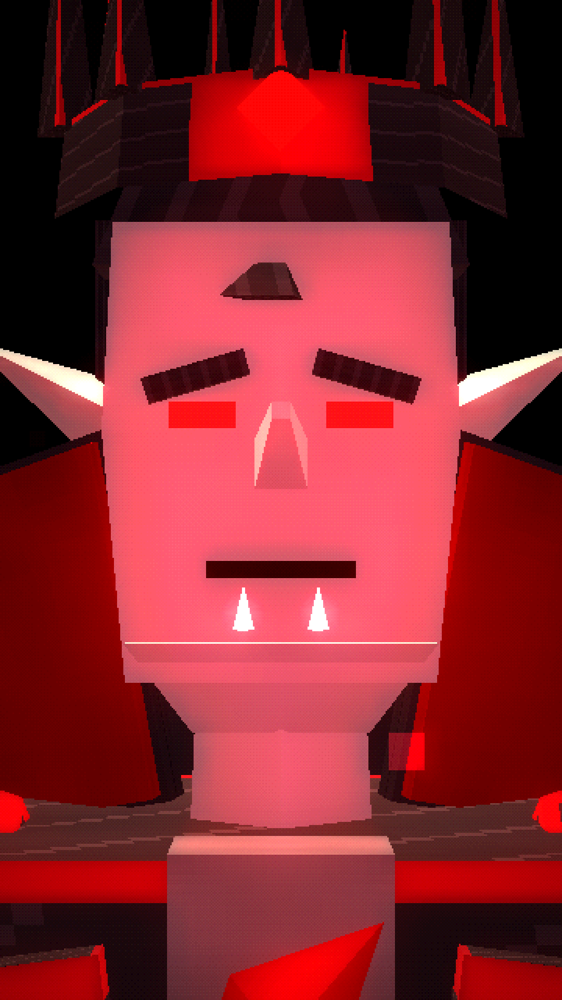

# WHAT IF YOU WERE BORN AS A VAMPIRE?



A ~62-second vertical (9:16, 1080×1920) PS1/PS2-era low-poly dark-fantasy origin story. You are born into a thousand-year bloodline beneath a crimson moon. You discover your hunger and your speed, and outlive everyone you love. When humanity's army comes, you become a swarm of bats, and then the Vampire King.

**Final video:** [`output/what_if_you_were_born_as_a_vampire.mp4`](output/what_if_you_were_born_as_a_vampire.mp4)

| | |
|---|---|
| Script, timing, design, look, audio, quality check | [`docs/PRODUCTION_NOTES.md`](docs/PRODUCTION_NOTES.md) |
| Vampire design sheet (turnaround, face, newborn, child, king, elders, humans, the swarm) | [`images/00_vampire_design_sheet.png`](images/00_vampire_design_sheet.png) |
| 25 scene keyframes | [`images/`](images/) |
| Contact sheet | [`docs/contact_sheet.jpg`](docs/contact_sheet.jpg) |

## Code
- `render/src/vampire.js`:
  - the vampire on one rig (newborn → child → noble → king), with a cloth cape;
  - elders and humans (the companions age over time);
  - the instanced bat swarm;
  - crimson smoke and aura.
- `render/src/vworld.js`:
  - the gothic castle under the crimson moon;
  - skies and lighting;
  - a gothic hall (candles, moonlit windows, decay);
  - the courtyard and the throne room.
- `render/src/shots.js` and `render/src/film.js`: the 25 shots and the timeline.
- `audio/`: the narration lines, the procedural gothic score and sound design (`synth.py`), and the subtitles.

Rebuild everything:

```bash
./build.sh
```
