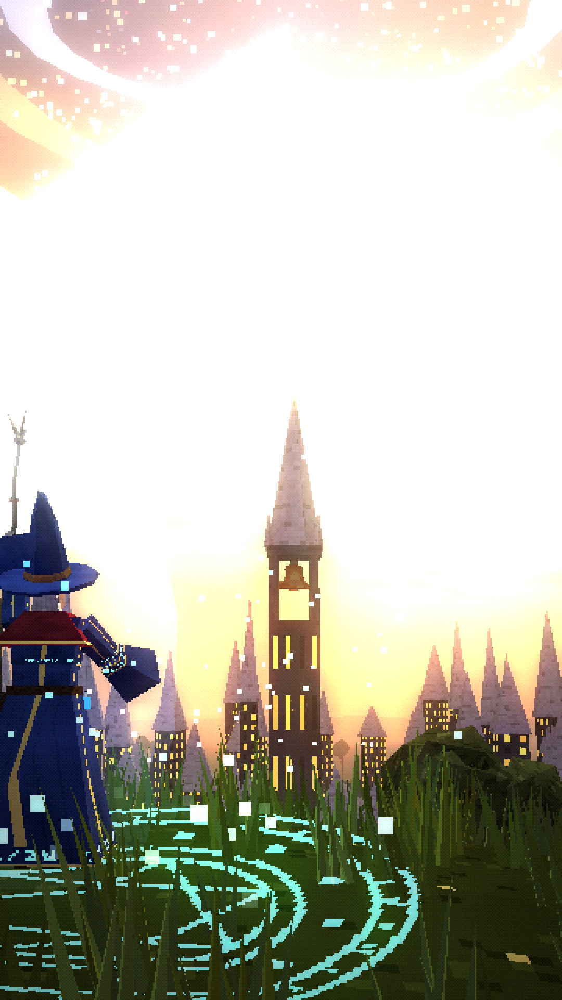

# TODAY YOU WILL LEARN HOW TO CAST SPELLS



A ~62-second vertical (9:16, 1080×1920) spell-casting lesson in a PS1/PS2-era low-poly fantasy world, framed like a tutorial inside an RPG. An old wizard teaches you mana and then three spells (Fireball, Lightning Bolt and Magic Shield) in a sunlit forest training ground, and ends on a hill above a kingdom at sunset.

**Final video:** [`output/today_you_will_learn_how_to_cast_spells.mp4`](output/today_you_will_learn_how_to_cast_spells.mp4)

| | |
|---|---|
| Script, timing, design, spells and FX, audio, quality check | [`docs/PRODUCTION_NOTES.md`](docs/PRODUCTION_NOTES.md) |
| Wizard design sheet (turnaround, face, staff, belt, mana, the three spells, the brute) | [`images/00_wizard_design_sheet.png`](images/00_wizard_design_sheet.png) |
| 18 scene keyframes | [`images/`](images/) |
| Contact sheet | [`docs/contact_sheet.jpg`](docs/contact_sheet.jpg) |

## Code
- `render/src/wizard.js`: the wizard (one rig), his staff, and the spell effects: rune circle, aura, mana motes, fireball, fire, shock rings, branching lightning ribbons and the shield dome.
- `render/src/sworld.js`: the forest training ground (rune stones, the target, the lightning menhir, the wizard tower) and the hill above the kingdom.
- `render/src/shots.js` and `render/src/film.js`: the 18 shots and the timeline.
- `render/src/sheet.js`: the design-sheet views.
- `audio/`: narration lines, the procedural score and spell sound design (`synth.py`), and the subtitles with lesson cards.

Rebuild everything:

```bash
./build.sh
```
