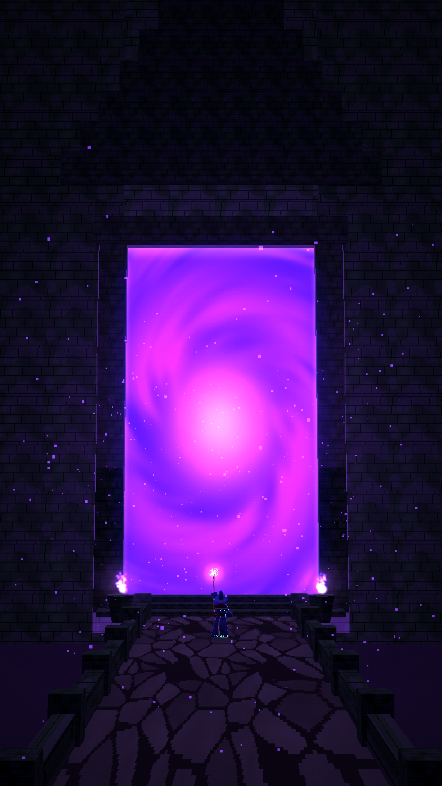

# DARK FANTASY CINEMATIC (30 s)



A 30-second vertical (9:16, 1080×1920, 30 fps) purely visual montage. It plays like scenes from a forgotten PS2-era dark-fantasy RPG, in PS1/PS2 low-poly 3D. It has **no voiceover, dialogue, music, sound effects, subtitles, text or logo**: the MP4 has no audio track, ready for your own score.

**Video:** [`output/dark_fantasy_cinematic_30s.mp4`](output/dark_fantasy_cinematic_30s.mp4)

| | |
|---|---|
| Shot list, design, animation, look, quality check | [`docs/PRODUCTION_NOTES.md`](docs/PRODUCTION_NOTES.md) |
| Design sheet (the Violet Smith, crusaders, wanderer, wizard, helms, weapons) | [`images/00_design_sheet.png`](images/00_design_sheet.png) |
| 8 keyframes | [`images/`](images/) |
| Contact sheet | [`docs/contact_sheet.jpg`](docs/contact_sheet.jpg) |

## Code
- `render/src/knight.js`:
  - armoured knights on one rig in three kits (the Violet Smith, the crusader, the dark wanderer), with jointed gauntlet fingers and a cloth cape;
  - a small numeric arm IK (`reach`) so a hand lands exactly on a hilt;
  - swords, axes, spears, shields and tankards.
- `render/src/worlds.js`:
  - the portal of the ancients (an animated portal shader);
  - the knights' hall;
  - the castle under a purple storm;
  - the abandoned village in instanced rain;
  - the cathedral with its floating crystal and rune rings;
  - the armory.
- `render/src/shots.js` and `render/src/film.js`: the 8 shots and the timeline.
- `render/src/sheet.js`: the design-sheet views.
- It reuses the hammer-strike system from `born-a-blacksmith`, the wizard from `cast-spells`, and the gothic hall and castle from `born-as-a-vampire`.

Rendered at 540×960 internally (2× nearest-neighbour upscale), with smoother colour and reduced texture warping so textures stay readable.

Rebuild everything:

```bash
./build.sh
```
