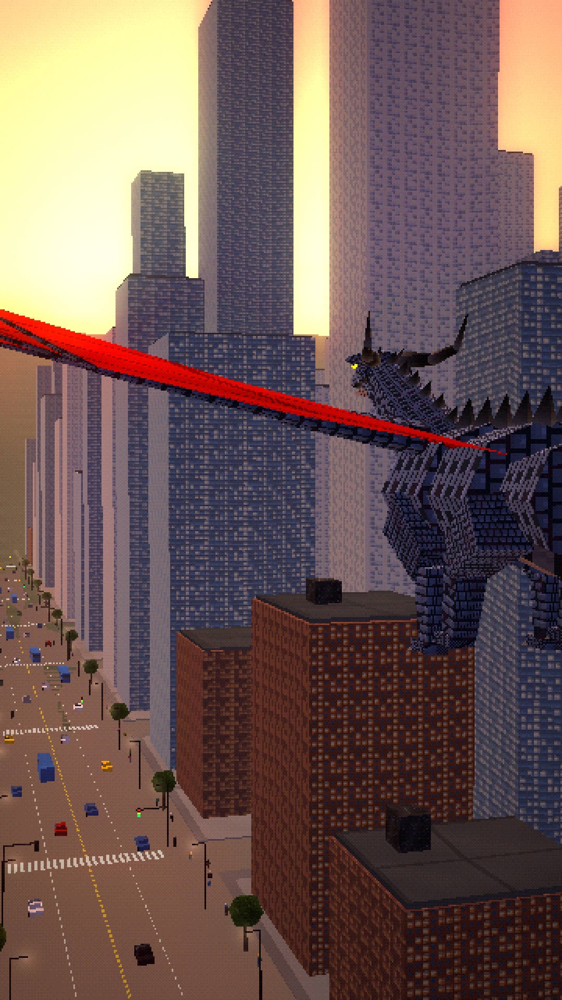

# WHAT IF DRAGONS STILL EXISTED?



A ~62-second vertical (9:16, 1080×1920) alternate-history documentary in a PS1/PS2-era low-poly style. It shows a modern Earth where dragons never went extinct, following them through:
- everyday city life
- the commute and air travel
- the industries that feed and care for them
- the dangers
- the laws
- the military
- a calm ending in which dragons are just part of everyday life

**Final video:** [`output/what_if_dragons_still_existed.mp4`](output/what_if_dragons_still_existed.mp4)

| | |
|---|---|
| Script, timing, design, look, audio, quality check | [`docs/PRODUCTION_NOTES.md`](docs/PRODUCTION_NOTES.md) |
| Design sheet (people, uniforms, dragon species, scale, vehicles, aircraft, signs) | [`images/00_design_sheet.png`](images/00_design_sheet.png) |
| 25 scene keyframes | [`images/`](images/) |
| Contact sheet | [`docs/contact_sheet.jpg`](docs/contact_sheet.jpg) |

## Code
- `render/src/modern.js`:
  - modern people: one shared body type, eight outfits;
  - instanced crowds and traffic;
  - cars, buses and emergency vehicles, airliners, fighter jets and a helicopter;
  - signs, and the dragon species with saddles, tags and armour (built on the dragon rig from `born-as-a-dragon`).
- `render/src/city.js`:
  - the city (day, sunset and dusk, with windows lighting up), its traffic lights and street lamps;
  - the airport with its dragon landing zone;
  - the sanctuary and the airbase.
- `render/src/shots.js` and `render/src/film.js`: the 25 shots and the timeline.
- `audio/`: the narration lines, the procedural documentary score and modern sound design (`synth.py`), and the subtitles.

Rebuild everything:

```bash
./build.sh
```
