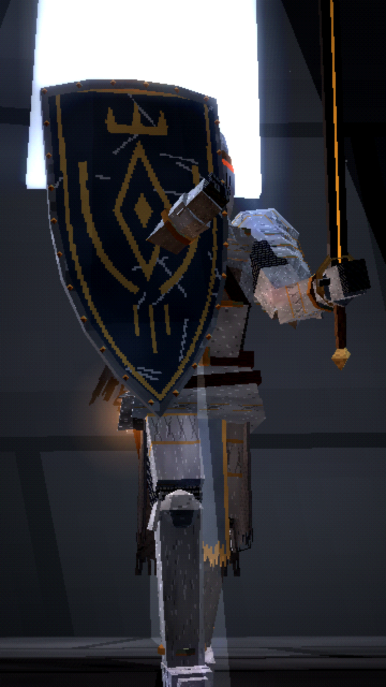

# VHALDREN — EPISODE 3: THE ARMOR THAT WOULD LAST FOREVER

*Cael Vorn: the legacy of an ancient order.*



A ~63-second vertical (9:16, 1080×1920, 30 fps) dark-fantasy short. In a forgotten fortress, Cael Vorn takes up **the Vigil Plate**, his **permanent** armour and shield from now on (see [`../CAEL_VORN_CANON.md`](../CAEL_VORN_CANON.md)).

**Final video:** [`output/the_armor_that_would_last_forever.mp4`](output/the_armor_that_would_last_forever.mp4)

| | |
|---|---|
| Title, narration, storyboard, image prompts, animation instructions, sound design, design notes | [`docs/PRODUCTION_BIBLE.md`](docs/PRODUCTION_BIBLE.md) |
| Permanent reference sheet (front, back, side, helm, chest, shield, full body) | [`images/00_cael_vorn_vigil_plate_reference_sheet.png`](images/00_cael_vorn_vigil_plate_reference_sheet.png) |
| The 10 new scene images | [`images/`](images/) |
| Contact sheet | [`docs/contact_sheet.jpg`](docs/contact_sheet.jpg) |

## Code
- `render/src/vigil.js`: **canon.** The Vigil Plate (helm, plate, pauldrons, mail, cloth, scarf), the Watchful Ember shield, the armour stand, and the old → new region swap. Future episodes call `buildCaelVigil()`.
- `render/src/fortress.js`: the fortress on its crag and the armory interior.
- `render/src/shots.js`, `render/src/film.js`, `render/src/sheet.js`: the 21 shots, the timeline and the reference sheet.
- `audio/`: narration lines, procedural score and foley (`synth.py`), and subtitles.

Rebuild everything:

```bash
./build.sh
```
