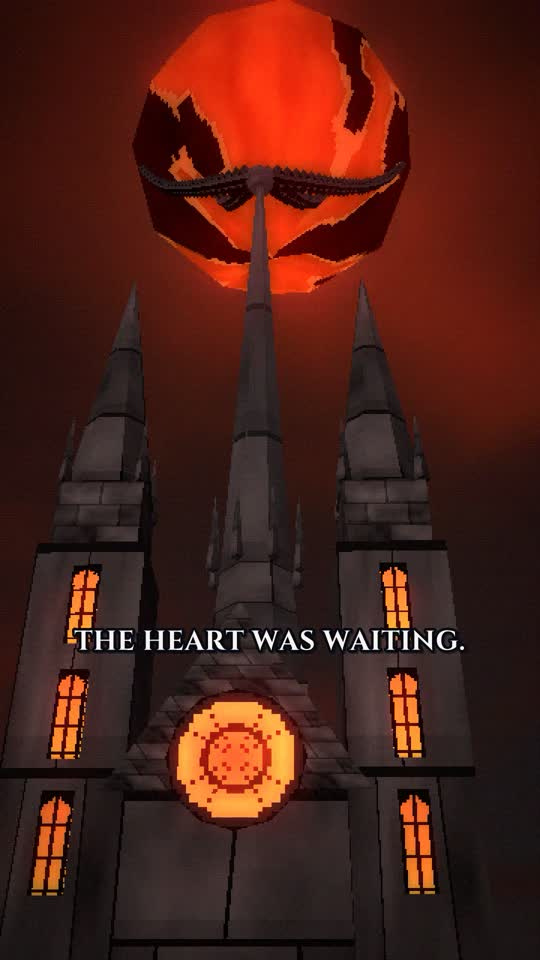

# THE LAST EMBER

*What if a wandering knight became the final guardian of a dying world?*



An original ~64-second vertical (9:16, 1080×1920, 30 fps) dark-fantasy short, made to look like a lost PS1/PS2-era game cinematic.
It is meant for YouTube Shorts, TikTok and Instagram Reels.

**Final video:** [`output/the_last_ember.mp4`](output/the_last_ember.mp4)

| | |
|---|---|
| Story, narration, storyboard, character designs, AI image and animation prompts, sound design, camera and transitions | [`docs/PRODUCTION_BIBLE.md`](docs/PRODUCTION_BIBLE.md) |
| Contact sheet of the finished film | [`docs/contact_sheet.jpg`](docs/contact_sheet.jpg) |
| Burned-in subtitles (ASS) | [`docs/subtitles.ass`](docs/subtitles.ass) |

## How it is made

Nothing in this film is a stock asset, copied asset or AI-generated image. It is a real low-poly 3D production rendered from code:

- `render/`: a three.js scene graph rendered in headless Chromium with custom retro shaders. These give affine texture warp, vertex snapping, Gouraud lighting, fog, Bayer dithering, 15-bit colour and bloom at an internal resolution of 360×640.
  - `src/characters.js`: Cael Vorn, the Ashwights, the ash statues and the Knellwyrm, built as segmented rigid-limb models.
  - `src/world.js`: the sky, the chained Ember Heart, the Ashen Cathedral, the bridge of Odran, ruins, the forest, the village, the Keeper's Seat and the carved wall.
  - `src/textures.js`: procedural pixel textures and sigils.
  - `src/shots.js` and `src/shots2.js`: the 20 shots (cameras, animation, effects). `src/film.js` holds the master timeline (cuts, dissolves, flashes, fades).
- `audio/`:
  - `tts.py`: narration with Kokoro-82M (Apache-2.0).
  - `synth.py`: a fully procedural original score and sound design (choir, drones, strings, taiko, bells, wind, fire, armour, roar).
  - `make_subs.py`: styled subtitles.
  - `timeline.py`: shared timing.
- `build.sh`: rebuilds everything end to end, from narration through frames, audio and subtitles to the final MP4.

### Rebuild

Requires Node 18+, Python 3.10+, ffmpeg (built with libass and rubberband), and Playwright with Chromium.

```bash
pip install kokoro-onnx soundfile numpy
```

```bash
./build.sh
```

The script downloads the Kokoro model files from their GitHub release, renders 1,920 frames (about 3 minutes on 4 CPU cores with software WebGL), synthesizes the audio and writes `output/the_last_ember.mp4`.

## Credits and licences

All story, characters, world, designs, visuals, music, sound effects and text are original to this project.
Tools and resources used: three.js (MIT), Kokoro-82M text-to-speech model and voices (Apache-2.0), the Cinzel typeface (SIL Open Font License 1.1, see `assets/fonts/OFL-Cinzel.txt`), and ffmpeg.
