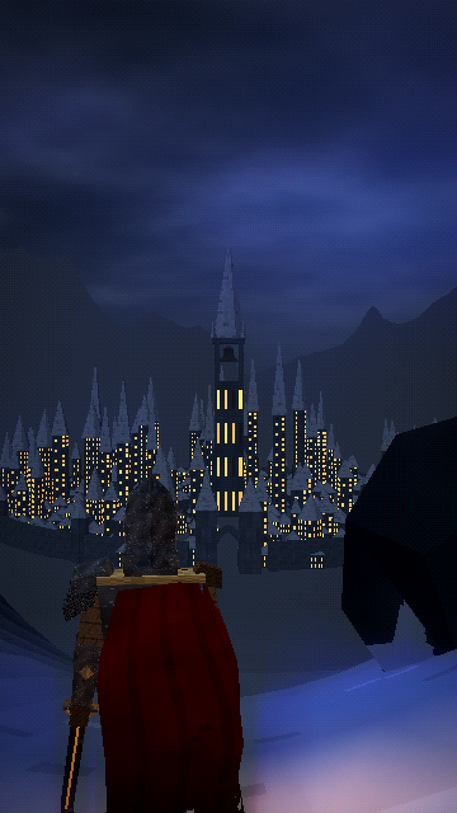

# VHALDREN — EPISODE 2: THE SILENT KINGDOM

*What if the knight found a kingdom where nobody could die?*



A standalone ~63-second vertical (9:16, 1080×1920, 30 fps) dark-fantasy short. It continues the original VHALDREN series with the **same Cael Vorn** from [Episode 1](../the-last-ember/).

**Final video:** [`output/the_silent_kingdom.mp4`](output/the_silent_kingdom.mp4)

| | |
|---|---|
| Title, narration, storyboard, image prompts, animation instructions, sound design, character consistency | [`docs/PRODUCTION_BIBLE.md`](docs/PRODUCTION_BIBLE.md) |
| The 10 new scene images (1080×1920) | [`images/`](images/) |
| Cael Vorn character reference sheet | [`images/00_cael_vorn_character_sheet.png`](images/00_cael_vorn_character_sheet.png) |
| Contact sheet of the finished film | [`docs/contact_sheet.jpg`](docs/contact_sheet.jpg) |

## How it is made

- `render/src/kingdom.js`: the new world. Snow mountains, the city of Aurelmoor with its golden windows, the Wakebell, the frozen fountain, the faceless Stilled, and the Stillwork machine with its iris, rings, gears and golden threads. Textures are procedural.
- `render/src/shots.js` and `render/src/film.js`: the 17 shots and the master timeline, including the hard cut to black at 0:57.4.
- `render/src/sheet.js`: the character turnaround.
- `audio/`:
  - `narration_lines.py`: the narration script.
  - `synth.py`: the new score and sound design (music box, whispers, machinery, the Wakebell, wind), built on Episode 1's toolkit.
  - `make_subs.py`: styled subtitles.
- **Character consistency is guaranteed by construction.** Cael, the retro shader engine and the textures are imported unchanged from `../the-last-ember/render/src/`; the narrator voice settings are identical.

Rebuild everything (frames, images, audio, subtitles, MP4):

```bash
./build.sh
```

Requirements are the same as Episode 1.
